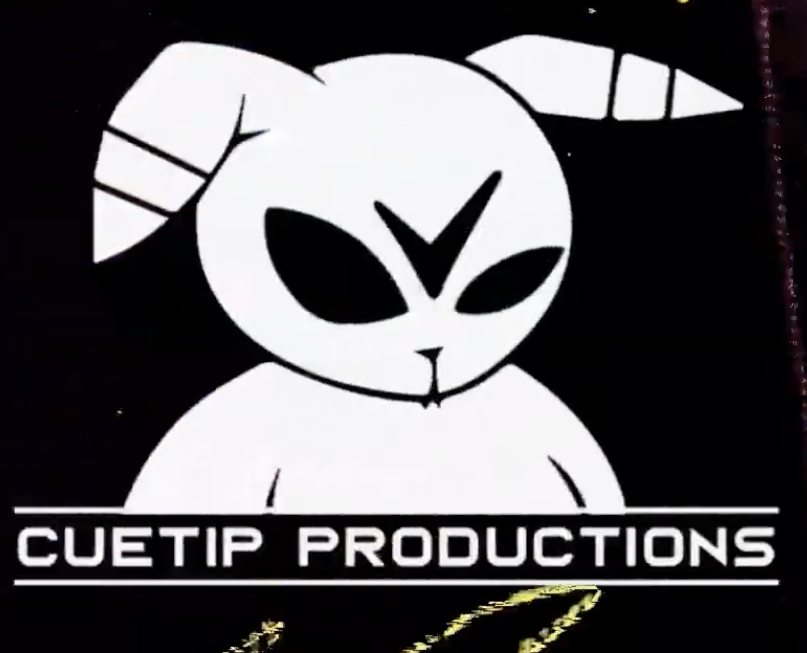

# Adventures of Cuetip, Vol. 1: Soul Searching

*A pixel-art story adventure with training battles, by **CuetipLLC / CueTip Productions**. 18+.*

Every night Cuetip dreams of a woman with impossibly long hair, standing beneath a tree made of
starlight: *Find me, before the dark does.* Then Vexmoor, the Rot King, curses him with **HS**, a black
disease that spreads across his body and will reach his heart unless he finds her. With his medicine,
Cuetip can keep going. Along the way he meets the friends who train him:

| Friend | Teaches |
|---|---|
| **Bramble**, the old tortoise monk | Guard & Parry |
| **Dr. Moss**, the moth healer | Focus, and the medicine shots that keep HS back |
| **Kit**, the fox swordswoman who walked out on Vexmoor | Dash Strike |
| **Ozzie**, the retired champion bear | Heavy Blow, and the Starfang Claws |

Three secret clues lead to the Black Spire, to Vexmoor, and finally to the Star Tree.

## Battles

Real-time and touch-friendly. The "!" over an enemy tells you what's coming:
yellow = guard or **parry** (tap Guard as it turns white), cyan = a lunge you can **dash** through,
green = a curse bolt that feeds HS, red = a slam. Enemies who turtle up need a charged **Heavy Blow**.

**HS** rises during every fight. Above 60% Cuetip is weaker and slower, above 85% it flares and
staggers him, at 100% it takes him down. A **Shot** pushes it back by 75%. Losing a fight offers
Retry, Retry (easier) or Skip.

Keyboard: J strike · K guard · L dash · I heavy (hold) · U focus · H shot · Esc pause.

## Develop

```bash
npm install
npm run serve      # http://localhost:8095
npm test           # plays the whole game in Chrome; a bot wins all 9 battles
npm run desktop    # desktop window
npx cap sync       # copy www/ into ios/ and android/
```

| File | What |
|---|---|
| `www/story.js` | the script (screenplay format, explained at the top of the file) |
| `www/battle.js` | battle rules, enemies and the 9 fights |
| `www/cast.js` | character portraits and battle sprites, drawn in code |
| `www/scenes.js` | backgrounds |
| `www/engine.js` | story runtime, UI, saves |
| `www/audio.js` | generated music and sound |

## Release

Same steps as Cuetip: Climb the Abyss (`~/cuetip-climb/docs/RELEASE.md`). Bundle ID
`com.cuetipllc.adventures` (permanent after the first store upload). Rated 18+: mark the itch.io
page as adult content; App Store 17+. Replace `CONTACT_EMAIL` in `www/privacy.html` first.
Disclose AI use: code, script, art and music were generated with Claude Code under CuetipLLC's direction.

## Credits

Cuetip, the story concept and all characters © CuetipLLC. All rights reserved.
Font: Pixelify Sans (SIL Open Font License 1.1, `www/fonts/OFL.txt`).
